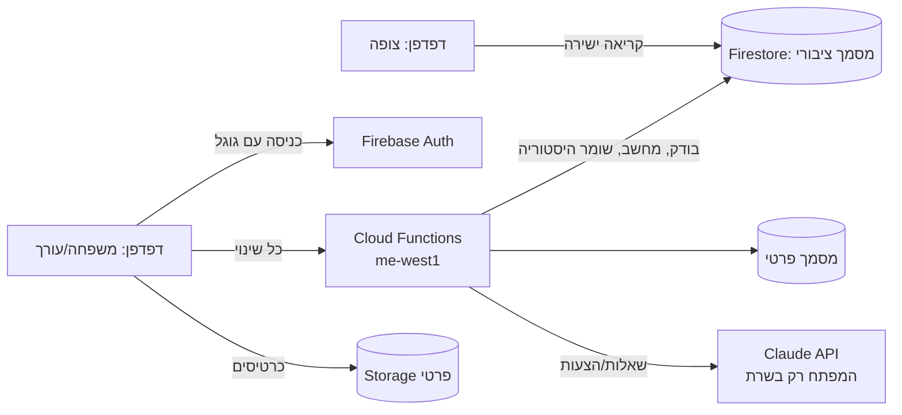

# הטיול המשפחתי לארה״ב — אתר עלויות ותכנון

אתר אחד שעונה על השאלה "כמה כל הטיול עולה, ומה כבר סגור?" — לכל המשפחה, בעברית, בטלפון.

- **כולם (בלי כניסה):** הסכום הכולל, לאן הולך הכסף, מה כבר סגור, המסלול, אפשרויות שאנחנו שוקלים.
- **משפחה (כניסה אחת עם גוגל):** גם כרטיסים ואישורי הזמנה, ושאלות ל-AI ("כמה עולים המלונות בניו יורק?").
- **עורכים:** משנים הכול — ידנית או במשפט ל-AI ("תוסיף עיר וושינגטון ל-2 לילות"). ה-AI רק מציע; עורך מאשר.

**הכול נתונים:** ערים ועצירות, קטגוריות, שורות, מחירים, מספר נוסעים, חדרים ורכבים, אפשרויות (למשל השייט), ואפילו סדר החלקים בעמוד הבית — הכול נערך מתוך האתר, בלי לגעת בקוד.

## איך זה עובד

- האתר עצמו סטטי (GitHub Pages, בלי build): `docs/`.
- כל שינוי עובר דרך פונקציה אחת (`commitChange`) שבודקת אותו שוב, מחשבת את הסכומים ושומרת היסטוריה — אפשר לבטל כל שינוי.
- מנוע החישוב (`docs/js/shared/`) משותף לדפדפן ולשרת, כך שהמספרים תמיד זהים.

## עלות
- GitHub Pages: חינם. Firebase (תוכנית Blaze): כמעט תמיד בתוך המכסה החינמית למשפחה.
- Claude (מודל Sonnet 5.5): בערך 1–5 סנט לשאלה, 5–15 סנט להצעה עם חיפוש מחירים. שימוש רגיל ≈ $6 בחודש. יש תקרה חודשית (ברירת מחדל $25) ומגבלה יומית לכל אדם — בהגדרות → AI.

## הקמה (פעם אחת — שחר עושה בעצמו)
1. **Firebase:** בחשבון הגוגל של בעל האתר צרו פרויקט (אצלנו: `usa-trip-2027-shahar`), עברו ל-Blaze והגדירו התראת תקציב.
2. **Firestore:** צרו מסד ב-`me-west1` (Tel Aviv), מצב production.
3. **Storage:** צרו bucket ב-`us-central1` (שם יש מכסה חינמית) ואשרו את ההרשאה ש-Firebase מבקש עבור כללים שקוראים מ-Firestore.
4. **Authentication:** הפעילו Google. ב-Settings → Authorized domains הוסיפו `shahards.github.io`.
5. **אפליקציית Web:** Project settings → Your apps → Web app. העתיקו את ה-config לקובץ `docs/js/config.js` (במקום `FIREBASE_CONFIG = null`). זה לא סוד.
6. **בעל האתר:** העתיקו את `functions/.env.example` ל-`functions/.env` ושימו בו `OWNER_EMAIL=` עם כתובת הגוגל של בעל האתר (הקובץ לא נכנס ל-git).
7. **מפתח Claude** (רק אתם מקלידים אותו):
   ```bash
   firebase functions:secrets:set ANTHROPIC_API_KEY
   ```
   ובקונסולת Anthropic הגדירו גם מגבלת הוצאה ל-workspace של המפתח.
8. **פריסה:**
   ```bash
   firebase use --add
   ```
   ```bash
   firebase deploy
   ```
   ```bash
   firebase functions:artifacts:setpolicy
   ```
9. **GitHub:** צרו repo ציבורי `usa-trip-2027`, דחפו, ו-Settings → Pages → Branch `main` / folder `/docs`.
10. **באתר:** היכנסו עם גוגל → הגדרות → גיבוי → **"טען נתוני פתיחה"** → הגדרות → גישה: הוסיפו את אבא ושאר המשפחה (ועורכים).

## שימוש יומיומי
- **לשנות מחיר:** "מצב עריכה" → קטגוריה → "עריכה" על השורה. כל חישוב מתעדכן מיד. "ביטול" בהודעה הקופצת או בהיסטוריה מבטל.
- **להוסיף עיר:** מסלול → "הוספת עיר או עצירה". הלילות יורדים מהעצירה ש"משלימה לילות" (אורלנדו), ואפשר להוסיף שורת מלון בלחיצה.
- **עם AI:** "שאלו" → "לשנות במשפט" / "הדבקת הצעת מחיר" → מקבלים רשימת שינויים → מסמנים → מאשרים.
- **כרטיס/אישור:** מסמכים → העלאה. ה-AI קורא ומציע: "הוזמן", מחיר בפועל, מועדי ביטול, קוד הזמנה (נשמר רק בחלק הפרטי).
- **WhatsApp:** כפתור "שיתוף בוואטסאפ" בראש העמוד. התצוגה המקדימה קבועה (לא מציגה את הסכום, כי וואטסאפ שומר אותה שבועות).

## בדיקות
```bash
npm test
```
```bash
npm run test:all
```
`npm test` — מנוע החישוב, האימות וכלי ה-AI (בלי רשת). `test:all` — גם כללי האבטחה ובדיקות קצה-לקצה מול אמולטורים של Firebase, עם "Claude מזויף" (`CLAUDE_FAKE=1` ב-`functions/.env.local`) כך שלא יוצא כסף.

הרצה מקומית: `npm run serve` ואז http://localhost:8150/usa-trip-2027/ (מצב הדגמה על נתוני הפתיחה; `?demo=editor` לנסות עריכה). מול אמולטורים: `npm run emulators` ואז `?emu=1`.

## לפני שמראים לאבא — בדיקה בטלפונים אמיתיים
- [ ] קישור מוואטסאפ באייפון נפתח בספארי, הסכום ברור, אין גלילה הצידה.
- [ ] באנדרואיד (כרום) אותו דבר.
- [ ] כניסה עם גוגל עובדת ונשמרת (לא צריך להיכנס שוב).
- [ ] שאלה בהקלטה דרך המיקרופון של המקלדת.
- [ ] כפתור "הקראה" קורא בעברית (אם אין קול עברי בטלפון — הכפתור לא מופיע).
- [ ] אם וואטסאפ פותח דפדפן פנימי — מופיעה ההודעה "פתחו בכרום / בספארי".

---

# USA trip hub (English)

A Hebrew, right-to-left website that answers "how much will the whole trip cost, and what is already booked?" for an 8-person family trip (30 Sep – 18 Oct 2027), readable by a non-technical parent on a phone.

- **Public link (no login):** total, where the money goes, how much is locked in, the route, options being considered.
- **Family (one Google sign-in):** tickets & confirmations, and "Ask the trip" (Claude answers in plain Hebrew; keyboard dictation works).
- **Editors:** change everything by hand or by asking Claude; Claude only *proposes* (a reviewed list of changes), an editor approves.

Everything is data: stops, categories, rows, prices, travellers, units, options and the home-page layout live in Firestore (`trips/usa2027/public/state` and `private/state`). The engine in `docs/js/shared/` is pure JS shared by the browser and the Cloud Functions.

**Layout**
| Path | What |
|---|---|
| `docs/` | the static site (GitHub Pages) — `js/shared` engine, `js/views` screens, `js/edit` editor, `data/seed-data.json` opening data |
| `functions/` | Cloud Functions (TypeScript, Node 24, me-west1): `commitChange`, `undoChange`, `whoami`, `getAccess`/`setAccess`, `adminImport`, `aiAsk`, `aiPropose`, `applyProposal`/`rejectProposal`, `addDocument` |
| `firestore.rules`, `storage.rules` | access rules (public summary readable by anyone; everything else family / editors; no browser writes to trip data) |
| `seed/reference-prices.md` | researched prices — background knowledge for the AI, not rows |
| `tests/` | unit tests (`npm test`), rules tests and emulator end-to-end tests (`npm run test:all`) |
| `notes/` | `ai.md` (Claude usage, verified SDK shapes, costs), `data-model.md`, `runbook.md` |

Setup steps are in the Hebrew section above (Firebase project on Blaze, Google sign-in, config in `docs/js/config.js`, `OWNER_EMAIL` in `functions/.env`, `ANTHROPIC_API_KEY` as a Firebase secret, deploy, GitHub Pages from `main /docs`, then "load opening data" in Settings → Backup).

Icons: [Lucide](https://lucide.dev) (ISC). Fonts: Heebo and Rubik (Google Fonts, OFL).
